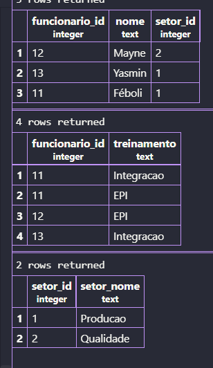

1. Criação da tabela original
```sql
CREATE TABLE cadastro_original (
    funcionario_id INTEGER PRIMARY KEY,
    nome TEXT,
    setor_id INTEGER,
    setor_nome TEXT,
    treinamentos TEXT
);
```

2. Inserindo os valores
```sql
INSERT INTO cadastro_original VALUES
(11, 'Féboli', 1, 'Producao', 'Integracao;EPI'),
(12, 'Mayne', 2, 'Qualidade', 'EPI'),
(13, 'Yasmin', 1, 'Producao', 'Integracao');
```

3. Criação da tabela de cadastro_1fn:
```sql
CREATE TABLE cadastro_1fn AS 
SELECT funcionario_id, nome, setor_id,setor_nome, 
    string_to_table(treinamentos, ';') AS treinamento
FROM cadastro_original;
```

4. Adicionei chave primaria
```sql
ALTER TABLE cadastro_1fn
ADD PRIMARY KEY ()
```

---
# 2fn

1. criando a tabela de funcionarios
```sql
CREATE TABLE funcionarios AS 
SELECT DISTINCT funcionario_id,nome,setor_id,setor_nome
FROM cadastro_1fn;
```

2. Adicionando as chaves primarias:
```sql
ALTER TABLE funcionarios
ADD PRIMARY KEY (funcionario_id);
```

3. Criar a tabela de participações:
```sql
CREATE TABLE participacoes AS SELECT funcionario_id,treinamento FROM cadastro_1fn;
```

4. Adicionar as chaves primarias:
```sql
ALTER TABLE participacoes
ADD PRIMARY KEY (funcionario_id,treinamento);
```
5. Add as chaves estrangeiras
```sql
ALTER TABLE participacoes 
ADD FOREIGN KEY (funcionario_id) REFERENCES funcionarios(funcionario_id);
```

6. Verificando as tabelas:
```sql
SELECT * FROM funcionarios;
SELECT * FROM participacoes
```

# 3fn
1. Criar a tabela dos setores:
```sql
CREATE TABLE setores AS SELECT DISTINCT setor_id, setor_nome FROM funcionarios;
```

2. Adicionar a chave primaria pros setores_id:
```sql
ALTER TABLE setores 
ADD PRIMARY KEY (setor_id)
```
3. Add chaves estrangeiras nos funcionarios
```sql
ALTER TABLE funcionarios
ADD FOREIGN KEY (setor_id) REFERENCES setores(setor_id);
```

4. Correção de erros na tabela pra não permitir nulo:
```sql
ALTER TABLE funcionarios
ALTER COLUMN setor_id SET NOT NULL
```

5. Apagar a coluna de setor nome:
```sql
ALTER TABLE funcionarios
DROP COLUMN setor_nome;
```

6. Consultando as 3 tabelas
```sql
SELECT * FROM  funcionarios;
SELECT * FROM participacoes;
SELECT * FROM setores;
```



